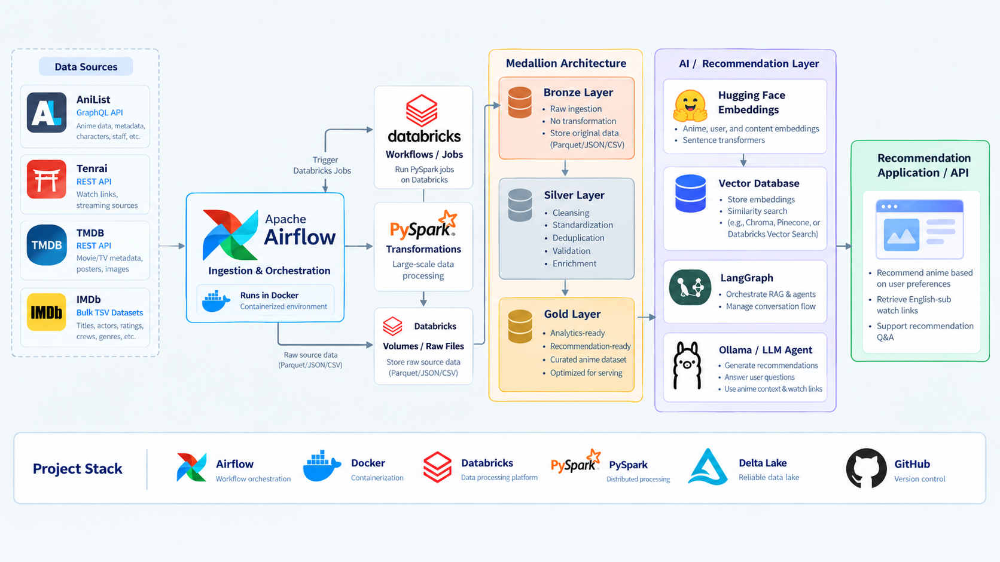

# Anime Data Platform

## Overview

This is my Databricks & AI project. The AI component is not implemented yet, as I am currently focusing on preparing for my exams. I plan to continue developing the project and implement the AI component after my exams.

Anime Data Platform is an end-to-end data engineering and AI project that ingests anime data from multiple sources, processes data using Databricks and the Medallion Architecture, and prepares curated datasets for an AI-powered anime recommendation and watch-link application.

The project combines traditional data engineering with AI by using:

- Apache Airflow for orchestration
- Databricks for distributed data processing
- PySpark for transformation
- Delta Lake for reliable storage
- Unity Catalog for data organization and governance
- SQL for structured recommendation queries
- Vector search for semantic recommendations
- LangGraph for AI agent orchestration
- A local LLM through Ollama or Llama
- Current streaming availability lookup for English-subbed viewing options

The main idea is to build a reliable data platform first, then use the curated data as the foundation for an AI recommendation system.

## Things to take note:
1. Schema Evolution and Column Changes

Validate the incoming dataset schema against the expected schema.

Handle new, missing, renamed, or changed columns.

Allow compatible changes, such as adding an optional column, when appropriate.

For breaking changes, such as a column changing from integer to string, log the issue and alert or stop the pipeline if data integrity is at risk.

Ensure schema changes do not silently break downstream Silver and Gold transformations.

2. Large Dataset Ingestion

For large datasets, ingest data in manageable batches instead of loading everything at once.

Use API pagination, incremental loading, or date-based partitions where supported.

Track ingestion progress using checkpoints or watermarks to avoid reprocessing previously completed data unnecessarily.

Make ingestion idempotent so that rerunning a failed task does not create duplicate records.

Process large bulk files separately from frequently updated API data when appropriate.

3. Logging, Monitoring, and Failure Handling

Record logs at every major pipeline checkpoint, including ingestion, Bronze, Silver, and Gold.

Capture execution status, start and end times, records read and written, rejected records, and error messages.

Monitor data quality checks, such as null values, duplicate records, schema mismatches, and unexpected record counts.

Configure retries and alerts for transient failures.

Ensure downstream tasks only run after upstream tasks complete successfully, and make failures easy to investigate.

4. PySpark Performance Optimization

Broadcast joins: Use broadcast() when joining a small lookup or dimension dataset with a much larger dataset, reducing unnecessary shuffle when appropriate.

Persist and cache: Use persist() or cache() for expensive DataFrames that are reused multiple times, avoiding repeated computation.

Release cached data with unpersist() when it is no longer needed.

Inspect query execution plans using explain() and review the Spark UI to identify expensive joins, shuffles, and data skew.

Optimize based on actual execution metrics rather than applying performance techniques blindly.

---

## Project Motivation

I created this project because anime with english subtitles are often taken down or the video is loading too slow.

## Project Architecture

## Data Flow
